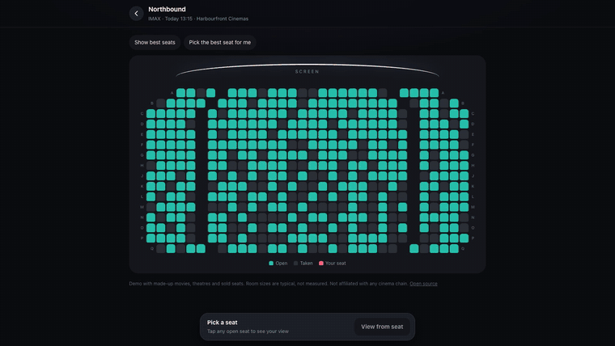
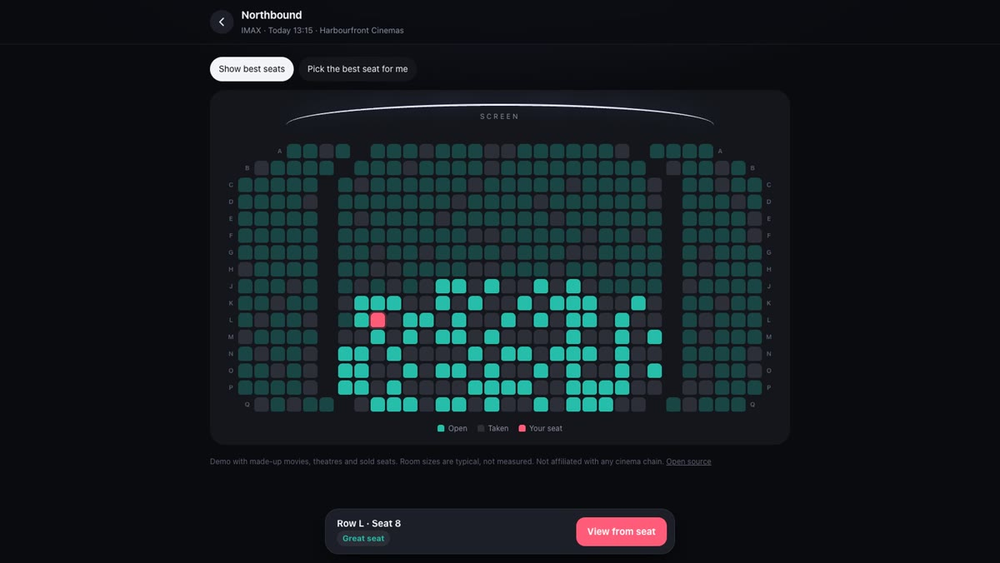
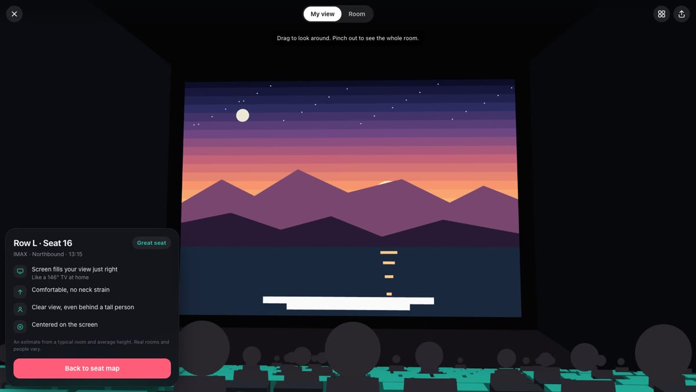
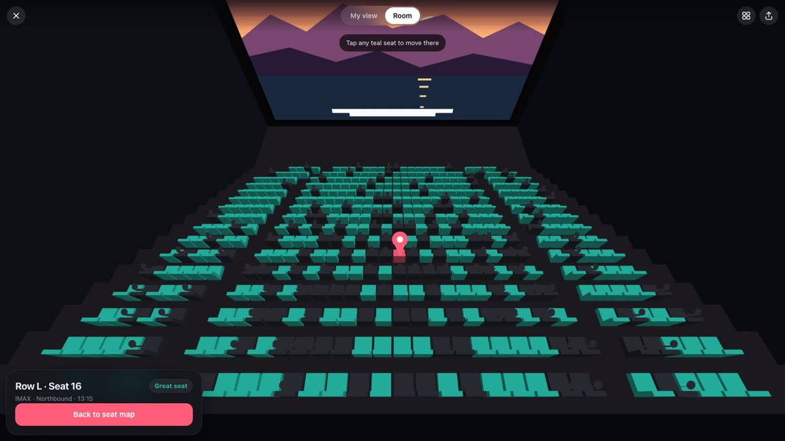
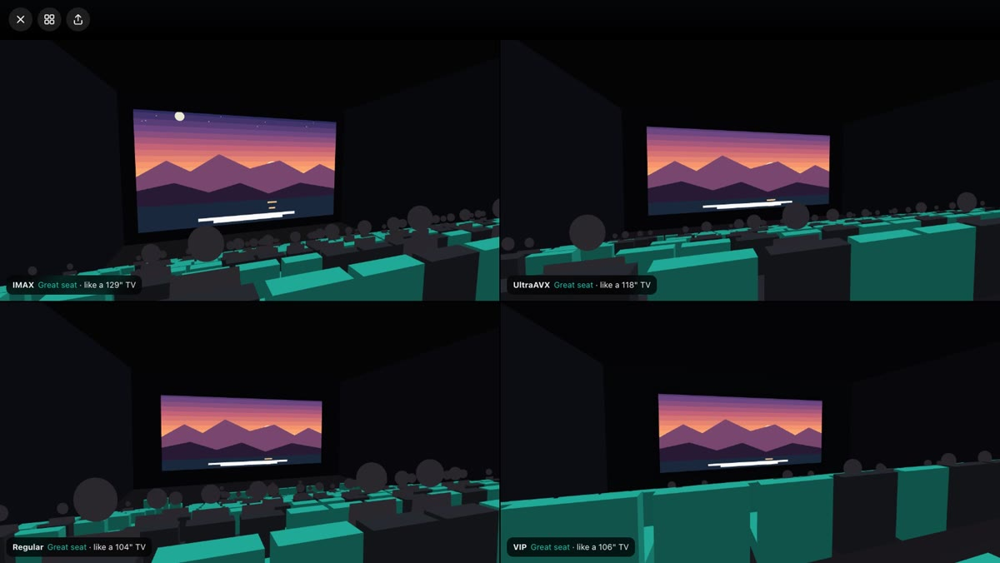
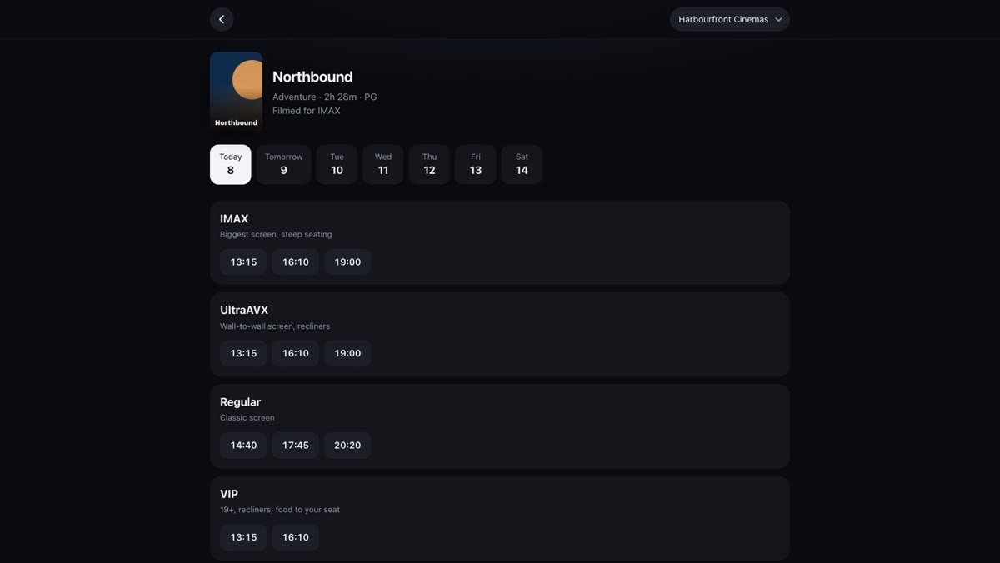
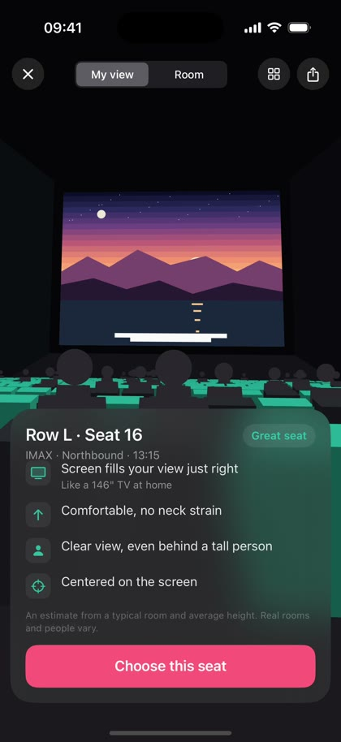

<div align="center">

# SeatSight

### Why doesn't any movie app show you the view from your seat?

SeatSight is a free, open source **3D seat preview** that shows it's easy. Tap a seat on a cinema seat map and fly into it to see the screen the way you will see it, for **IMAX, UltraAVX, Regular and VIP** auditoriums. Web and iPhone. No server, no 3D engine, about 48 KB. Cinema chains already have the room data. This is the missing piece.

[**Try the live demo**](https://alireza12t.github.io/seatsight/) · [How it works](#how-it-works) · [For cinema chains](#for-cineplex-and-other-cinema-chains) · [Room data format](#room-data-format)

[](https://alireza12t.github.io/seatsight/)


[](LICENSE)

**▶ Watch: [How I built it, iPhone first (4 min)](https://youtu.be/xLEtWH8cA_4)**

<a href="https://youtu.be/xLEtWH8cA_4"></a>



</div>

## The problem

Every movie booking app shows the same thing: a flat grid of squares. You pick one and hope.

But row F in an IMAX auditorium and row F in a VIP room are completely different seats. Screen size, distance, how far you look up, whether the person in front blocks the subtitles: the seat map tells you none of it.

So why don't booking apps just show you the view from the seat? It isn't a hard problem:

- **It's tiny.** The whole web app is about 48 KB with zero dependencies. The renderer is one 18 KB file.
- **It needs no new backend.** No server, no 3D engine, no SDK. It draws into a canvas next to the seat map that's already there.
- **The data already exists.** Every auditorium was built from drawings with the screen size, row spacing and floor rise in them.

**SeatSight is the proof. Cinema apps should have this.** If you agree, share it and tag Cineplex.

## Features

- **3D view from any seat.** Tap a seat on the map and the camera flies from the back of the auditorium into it. Drag to look around, pinch to zoom.
- **Open and taken seats you can read.** Open seats are teal. Taken seats have a person sitting in them, so you see whose head you'll get.
- **Whole-room view.** Pinch out to see the auditorium from above with a pin on your seat. Tap any open seat to move there.
- **A plain verdict.** Great, Good, Okay or Not ideal, with four simple lines: screen size ("like a 146 inch TV at home"), neck comfort, heads in front, and how centered you are.
- **Pick the best seat for me** and **Show best seats** on the seat map.
- **Compare screen types.** The same spot in IMAX, UltraAVX, Regular and VIP side by side.
- **Real aspect ratios.** A movie filmed for IMAX shows more of the picture on a 1.43:1 IMAX screen. A scope movie gets bars.
- **Booking-style flow.** Theatre, movie, showtime by screen type, then seats. Shareable links to any seat.
- **Web and native iOS** from the same room data and the same math.

## Screenshots

| Seat map | View from your seat | Whole room |
|---|---|---|
|  |  |  |

| Compare IMAX, UltraAVX, Regular, VIP | Showtimes by screen type | iPhone app |
|---|---|---|
|  |  |  |

## Try it

**Web:** [alireza12t.github.io/seatsight](https://alireza12t.github.io/seatsight/). Or run it locally:

```bash
python3 -m http.server 8000 --directory docs
```

**iOS (17+):** open `ios/SeatSight.xcodeproj` in Xcode and run. Regenerate the project with `xcodegen` from `ios/` if you add files. The app bundles `docs/auditoriums.json`, so web and iOS always use the same rooms.

## For Cineplex and other cinema chains

This was built as an open invitation to **Cineplex** (and any cinema chain) to add a 3D seat preview to their booking flow. It is designed to be easy to adopt:

- **No new infrastructure.** No server, no 3D engine, no SDK. Rendering is about 300 lines of JavaScript (`docs/engine.js`, 18 KB) and three Swift files on iOS.
- **Your data, not ours.** Each auditorium is a small JSON entry: screen width, aspect ratio, row spacing, floor rise and row layout. Your building plans already have these numbers.
- **Drops into an existing seat map.** The engine takes a room and a seat and draws into a canvas. Your seat map, pricing and checkout stay exactly as they are.
- **Cheap to run.** It only redraws while the camera moves, so an idle view costs nothing.

If you want this in the Cineplex app, **tag Cineplex** when you share it.

## How it works

SeatSight draws 3D with its own tiny renderer on a 2D canvas (Canvas2D on the web, SwiftUI `Canvas` on iOS):

1. **Camera** from two angles, yaw and pitch.
2. **Projection:** each point moves into camera space and is divided by its depth.
3. **Near-plane clipping**, so geometry behind you can't flip into view.
4. **Back-face culling** skips faces pointing away from you.
5. **Painter's algorithm:** faces are sorted by depth and painted far to near.
6. **Flat shading and distance fog** give the room depth.
7. **Tap picking** with point-in-polygon on the projected seat faces, falling back to the nearest seat within 24 px.

The movie on screen is one fixed picture, and each screen's aspect ratio crops it with the same polygon clipping. That's why IMAX shows more sky.

### The seat score

| Check | What it measures |
|---|---|
| Screen size | Horizontal viewing angle (atan2) vs the ideal for that format, based on THX and SMPTE guidance |
| Neck | How far you look up to the top edge of the screen |
| Centered | How far off-axis you sit |
| Heads in front | The **C-value**: how far your sightline to the bottom of the screen clears the eye of the person in front. It also checks a person about 10 cm taller |

The four checks combine into one word: Great, Good, Okay or Not ideal. Details and sources are in [RESEARCH.md](RESEARCH.md).

## Room data format

```json
{
  "id": "vip", "name": "VIP", "format": "VIP",
  "screen": { "width": 11, "aspect": 2.39, "bottom": 1.0 },
  "firstRow": 4.5, "rowPitch": 1.65, "riser": 0.55, "flatRows": 0,
  "seatWidth": 0.85, "aisle": 1.1, "eyeHeight": 1.05, "idealAngle": 45,
  "rows": ["2-8-2", "2-10-2", "2-10-2", "2-10-2"]
}
```

Units are meters. `"2-10-2"` means 2 seats, an aisle, 10 seats, an aisle, 2 seats. All rooms live in [`docs/auditoriums.json`](docs/auditoriums.json).

## How accurate is it?

It's an estimate, and the app says so.

- Room sizes are **typical values, not measured plans** of any real auditorium. No chain publishes them. With real drawings the view would be exact.
- Movies, theatres, showtimes and sold seats in the demo are **made up**.
- Seat scoring uses published viewing guidance with weights chosen for this project.
- **Not affiliated with Cineplex** or any cinema chain.

## Project structure

```
docs/            web app, served by GitHub Pages
  engine.js      the renderer and seat scoring (reusable, no dependencies)
  app.js         booking flow and UI
  auditoriums.json  rooms, theatres, demo movies
ios/             SwiftUI app (Engine.swift mirrors engine.js)
RESEARCH.md      formats, viewing standards, sources
PLAN.md          roadmap and open items
```

## Roadmap

- Real auditorium data from cinema chains
- Curved IMAX screens and staggered seating
- Gyro look-around on iPhone
- An embeddable widget for any booking site

Ideas and pull requests are welcome. Open an issue with the auditorium you'd like to see.

## License

[MIT](LICENSE). Use it, ship it, put it in your booking app.

---

<sub>Keywords: cinema seat view, movie theater seat preview, 3D seat map, seat selection, IMAX seat view, UltraAVX, VIP cinema, Cineplex, best seat in the theater, view from seat, auditorium sightlines, C-value, SwiftUI Canvas, Canvas2D 3D renderer, zero dependencies.</sub>
